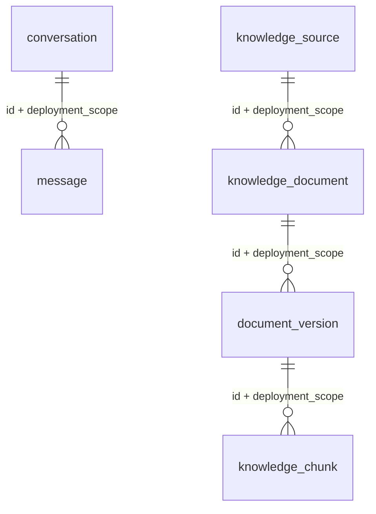

# Phase 03 discovery, scope and ERD (2026-10-24)

## Verified baseline and development gate

- Repository: `Amirmahdimtz/smart-chatbot-service`, branch `main`, HEAD `eb918b1f27c6028ca9d19c118973d8e165bb661f`; GitHub authenticated read and push permissions confirmed.
- Existing: four-layer FastAPI project, per-app discovery container, constructor `@inject`, `ConfigReader`, asynchronous `VaultService`, HTTP identity middleware, CI, 36 owner-reported phase-02 regressions.
- Missing at baseline: PostgreSQL context/repository/model/Alembic tree. No baseline schema or migration, no trusted organization database endpoint.
- Phase 01 and 02: `IMPLEMENTED_AWAITING_VERIFICATION`. ADR-0005: development-only with isolated PostgreSQL and synthetic records. No production deployment or organization migration permission.
- This design is a *technical provisional schema*, not an approved HR classification/retention/access policy. Owner sign-offs remain open.

## Scope / usage decision

| Logical entity | Phase 03 SQL table | Consumer contract / deferral |
|---|---|---|
| conversation | Yes | Persistent identity/ownership and state for future Phase 10; scoped service and integration checks in Phase 03 |
| message | Yes | Sequencing, idempotent append, owner verification and transaction tests; no HTTP or production content approved |
| knowledge_source | Yes | Structural source identity for Phase 05, composite scope boundary |
| knowledge_document | Yes | Document identity under a source for Phase 05 |
| document_version | Yes | Immutable version identity, checksum, draft/revoked only; publication awaits governance |
| knowledge_chunk | Yes | Version-scoped citation identity for Phase 06, reference only; no OCR/index |
| index_manifest | No | Phase 07 indexing/version contract; requires confirmed Qdrant/index schema |
| ingestion_job | No | Phase 05 worker, retries, leases and idempotency definition |
| approved_answer, answer_citation | No | Phases 09/11; expert/publisher and citation policy |
| approval_request | No | Phase 11/17; approval actor/workflow policy pending |
| agent_operation | No | Phase 15; no live Agent contract |
| feedback | No | Phase 10/11 after consent/retention policy |
| audit_event | No | Immutable audit storage, access and retention pending D-08; Phase 02 safe HTTP telemetry is not a substitute |
| user_preferences | No | Phase 10/14; informed consent needed |

## ERD (schema 0001)

- IDs are application-generated UUIDs, PostgreSQL `uuid`, and `created_at`/`updated_at` are `timestamptz` (PostgreSQL session timezone should be UTC); monotonic message sequence unique per conversation.
- Composite FKs enforce deployment scope on each edge. Public/Internal also require **physically distinct PostgreSQL databases, network controls and credentials**; a column is *not* a cross-deployment security boundary.
- `owner_principal_id` and `deployment_scope` are mandatory for conversation/source; `ConversationRepository` requires both for read/list/append. Other tables have no external read APIs and cannot be published. Actual identity principal must come from the authenticated request context in Phase 10, never a client-controlled string.
- `Conversation.revision` uses SQLAlchemy optimistic version detection. Appending serializes on a row-level `FOR UPDATE` lock, allocates sequence inside a single transaction, and enforces a unique scoped idempotency key. Concurrent unrelated tasks must use independent `AsyncSession`.
- `document_version.state` is restricted to `draft` and `revoked`; no SQL state can publish to Public at this gate. `classification` is nullable because official categories/policy are still unapproved; an unset value must mean DENY, not Public.
- Foreign keys use RESTRICT, not cascading content deletion. Retention, legal hold, archive and purge remain D-08 decisions; never infer retention from these columns.
- Owner+scope+created_at index is justified by the single real paginated scoped query. Other FK/ordinal unique constraints serve integrity; additional retrieval indexes depend on future measured query patterns.

## Migration and lifecycle plan

1. Environment-scoped `SCB_DATABASE_ENABLED=true` opt-in; only credential injected by environment or the existing Vault KV v2 provider. Nondevelopment connections require certificate-verified TLS. No checked-in real URL.
2. SQLAlchemy async engine and pool created **once per app lifespan**, readiness gated by successful connection and Alembic head; graceful dispose. No Session shared across users/tasks.
3. `BaseRepository` owns a transaction when no caller session is supplied. Caller-provided session is **not committed or rolled back** by the repository, allowing multi-repository atomic work.
4. Alembic revision `0001_foundation`: explicit schema creation; upgrade on empty dedicated database; repeated upgrade; `--check` for schema drift. PostgreSQL advisory lock rejects a concurrent migrator.
5. Destructive reverse only via `--downgrade-test-only`, with development/integration environment plus database name ending `_test`; CI may exercise it with disposable synthetic database.
6. Never run downgrades, schema creation, or online migrations automatically during application startup. Real organization DB changes require separate signed change approval, least-privileged migration role, verified pre-migration backup and restore drill.

## Security risks, decisions, prerequisites

- **BLOCKED_DECISION:** D-07 principal format/SSO, D-08 classifications, content retention, audit storage, ownership and approval policy; domain owners Security/Privacy/HR/Knowledge; due: prior to consuming real data or exposing any Phase 10/05 write route.
- **BLOCKED_EXTERNAL:** live test/staging PostgreSQL, separate public/internal credentials and network boundaries, TLS CA, migrations performed by an approved migration identity; Infrastructure/Security owner, due before organizational acceptance.
- **NOT_RUN pending test evidence:** PostgreSQL CI/container verification, concurrent duplicate/revision tests, backup/restore and real deployment integration must have separate recorded outputs.
- Phase 04 (Qdrant) is outside this work. No agent, upload, OCR or LLM provider is introduced.
